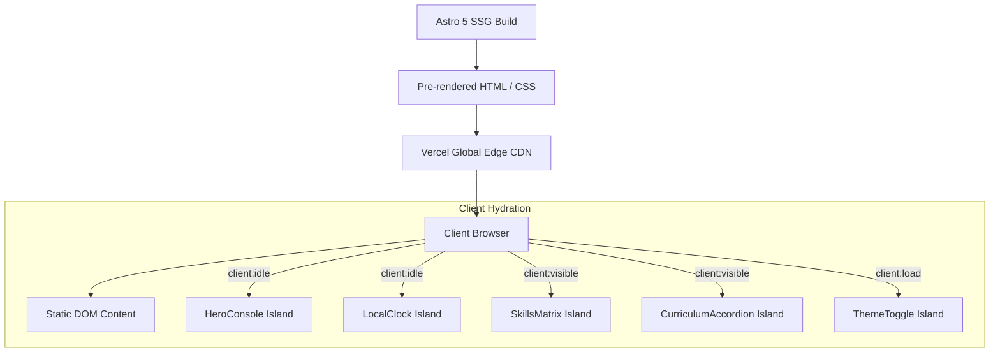

# Technical Architecture & Engineering Specifications

This document outlines the architectural decisions, design system, performance strategies, and engineering patterns implemented in **bencoder.site**.

---

## 1. Core Architectural Principles

1. **Static by Default (Zero-JS Baseline):** The entire site is pre-rendered at build time via Astro 5 Static Site Generation (SSG). Client-side JavaScript is only loaded when explicit user interaction is required.
2. **Selective Island Hydration:** Where dynamic client state is needed (e.g., interactive terminal console, localized live clock, copy email feedback, accordion transitions), isolated React 19 islands are hydrated using Astro's `client:visible` or `client:idle` directives.
3. **Monochrome Brutalist / Editorial Aesthetic:** Design relies on typography, whitespace rhythm, structural borders, and subtle grayscale contrast rather than saturated accent colors. The only intentional color token is the green availability status indicator (`#10B981`).
4. **Self-Hosted Assets:** Fonts, icons, and media are bundled locally without external CDN dependencies at runtime, ensuring robust privacy, zero third-party tracking, and optimal performance under constrained network environments.

---

## 2. Rendering Pipeline & Island Hydration



### React Island Strategy

| Component                 | Hydration Directive | Rationale                                                                      |
| :------------------------ | :------------------ | :----------------------------------------------------------------------------- |
| `ThemeToggle.tsx`         | `client:load`       | Required immediately on page load to allow user theme switching without lag.   |
| `LocalClock.tsx`          | `client:idle`       | Displays live Mostaganem (UTC+1) local time; non-blocking for initial paint.   |
| `HeroConsole.tsx`         | `client:idle`       | Interactive terminal emulator displaying developer bio and stats.              |
| `SkillsMatrix.tsx`        | `client:visible`    | Interactive filterable skills taxonomy; hydrated only when scrolled into view. |
| `CurriculumAccordion.tsx` | `client:visible`    | Expandable course syllabus breakdown for Everest Academy & Udemy courses.      |
| `CopyEmailButton.tsx`     | `client:visible`    | One-click clipboard copy utility with fallback for legacy environments.        |

---

## 3. Internationalization (i18n) & RTL Engine

The site features native bi-directional localization across English (LTR) and Arabic (RTL).

### Subpath Routing Structure

- **Default Locale (English):** `/`, `/work`, `/work/[slug]`, `/teaching`, `/about`
- **Arabic Locale:** `/ar`, `/ar/work`, `/ar/work/[slug]`, `/ar/teaching`, `/ar/about`

### RTL Typography & Layout Considerations

1. **Dynamic Font Stacking:**
   - English routes use **Geist** (`@fontsource-variable/geist`) for geometric precision and **Instrument Serif** (`@fontsource/instrument-serif`) for editorial headings.
   - Arabic routes dynamically apply **IBM Plex Sans Arabic** (`@fontsource/ibm-plex-sans-arabic`) to ensure natural legibility and authentic Arabic typographic proportions.
2. **Directional Flow (`dir="rtl"`):**
   - The root `<html>` tag automatically toggles between `dir="ltr"` and `dir="rtl"` based on the route prefix.
   - Layout primitives use logical Tailwind utilities (`ms-`, `me-`, `ps-`, `pe-`, `start-`, `end-`) to flip alignment and margins symmetrically.
3. **Structured Arabic Translations:**
   - Localization dictionaries are partitioned in `src/i18n/ui.ts`, `src/i18n/projects.ar.ts`, and `src/i18n/experience.ar.ts`.

---

## 4. Design System & Theme Engine

### Color Tokens (CSS Custom Properties)

The styling system is configured in `src/styles/global.css` using Tailwind CSS v4 `@theme` variables:

```css
:root {
  --background: #ffffff;
  --surface: #f8f8f8;
  --surface-2: #efefef;
  --border: #e5e5e5;
  --border-strong: #737373;
  --text: #0a0a0a;
  --text-muted: #525252;
  --status: #10b981;
}

[data-theme='dark'] {
  --background: #0a0a0a;
  --surface: #121212;
  --surface-2: #1c1c1c;
  --border: #262626;
  --border-strong: #525252;
  --text: #f5f5f5;
  --text-muted: #a3a3a3;
  --status: #10b981;
}
```

### Zero-FOUC (Flash of Unstyled Content) Mitigation

To eliminate theme flicker on page load, a tiny blocking inline script is placed in `<head>` before any stylesheet or markup renders:

```html
<script is:inline>
  const storedTheme = localStorage.getItem('theme');
  const systemPrefersDark = window.matchMedia('(prefers-color-scheme: dark)').matches;
  const theme = storedTheme || (systemPrefersDark ? 'dark' : 'light');
  document.documentElement.setAttribute('data-theme', theme);
</script>
```

---

## 5. SEO & Structured Data

1. **JSON-LD Schema Graphs:**
   - `Person` schema: Outlines full professional identity, roles (_AI Instructor_, _Software Engineer_, _Content Creator_), educational credentials (_Université Abdelhamid Ibn Badis_), and verified social profiles (GitHub, LinkedIn, Instagram).
   - `WebSite` schema: Declares canonical URL (`https://bencoder.site`) and multilingual site identity.
2. **Canonical and Hreflang Tags:**
   - Every page declares reciprocal `<link rel="alternate" hreflang="en" ...>` and `<link rel="alternate" hreflang="ar" ...>` headers, accompanied by `hreflang="x-default"` pointing to the default English version.
3. **Automated Sitemap:**
   - `@astrojs/sitemap` compiles dynamic `sitemap-index.xml` and route catalogs on every production build.

---

## 6. Accessibility & Compliance (WCAG 2.1 AA)

- **Contrast Ratios:** Text-to-background contrast ratios exceed the 4.5:1 minimum for normal text and 3:1 for large text across both light and dark themes.
- **Focus Rings:** Explicit `:focus-visible` styling (`outline-2 outline-offset-2 outline-text`) applied to all interactive controls and links.
- **Screen Reader Announcements:** Hidden descriptive announcements (`.sr-only`) on copy buttons and dynamic notifications with `aria-live="polite"`.
- **Keyboard Navigation:** Native button and anchor elements utilized with logical tab index order.
